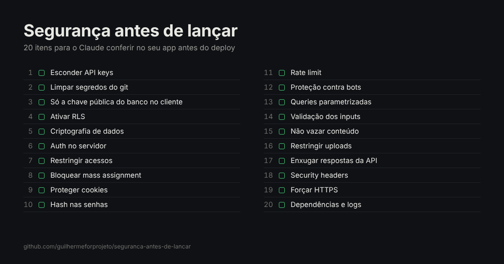

# Security before you launch

**20 security checks for Claude (or ChatGPT, Cursor, Copilot) to run on your app before you deploy, with a ready-to-paste audit prompt.**

[🇧🇷 Português](README.md) | 🇺🇸 English

Built your app with AI and about to ship it? Paste the prompt below first and have the AI audit its own code: API keys in the frontend, RLS turned off, unhashed passwords and routes with no rate limit are the most common mistakes in fast-built apps.

---

## The 20 checks

| # | Check | # | Check |
|---|---|---|---|
| 1 | Hide API keys | 11 | Rate limiting |
| 2 | Clean secrets from git | 12 | Bot protection |
| 3 | Only the public DB key on the client | 13 | Parameterized queries |
| 4 | Enable RLS | 14 | Input validation |
| 5 | Encrypt data | 15 | Don't leak content |
| 6 | Server-side auth | 16 | Restrict uploads |
| 7 | Restrict access | 17 | Trim API responses |
| 8 | Block mass assignment | 18 | Security headers |
| 9 | Protect cookies | 19 | Force HTTPS |
| 10 | Hash passwords | 20 | Dependencies and logs |

Each check is explained in one line in the prompt: what to look at and what "done" looks like.

## How to use it

1. Open your project in Claude Code, Cursor, Copilot, or a chat with your code attached.
2. Copy **[`prompts/en.md`](prompts/en.md)** and send it as a message.
3. The AI reports each check as ✅ OK, ❌ Issue or ➖ Not applicable, with file, line and fix, then a list sorted by severity.

### Make it permanent

Paste the prompt into your Claude Project instructions, `CLAUDE.md`, ChatGPT GPT/Project instructions, `.cursor/rules/`, `.github/copilot-instructions.md` or `AGENTS.md`.

## Important

This checklist catches the most common mistakes, but it is not a substitute for a real security assessment. If your app handles sensitive data, payments or health information, get a professional review.

## Contributing

Missing a check? Have a fix example for Supabase, Firebase, Next.js or another stack? Open an issue or a pull request.

If this helped, a ⭐ helps others find it.

## Credits

Checks 1 to 19 come from a TikTok video by **[@cruzdanielcruzzz](https://www.tiktok.com/@cruzdanielcruzzz)**. The video's timer runs out before the 20th, so check 20 (dependencies and logs), the explanations, the audit prompt and the English version were added here.

More prompts in the same style: [dashboard-sem-cara-de-ia](https://github.com/guilhermeforprojeto/dashboard-sem-cara-de-ia).

## License

[CC BY 4.0](LICENSE): use, copy, adapt and redistribute freely, commercially too. Just credit the source with a link to this repo.
