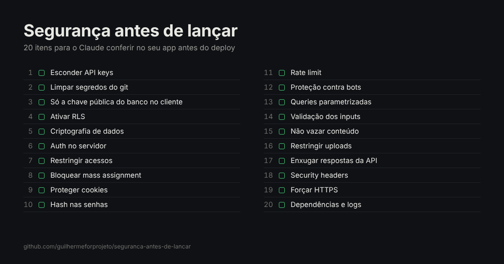

# Segurança antes de lançar

**20 itens de segurança para o Claude (ou ChatGPT, Cursor, Copilot) conferir no seu app antes do deploy, com um prompt de auditoria pronto para colar.**

🇧🇷 Português | [🇺🇸 English](README.en.md)

Fez o app com IA e vai colocar no ar? Antes disso, cole o prompt abaixo e peça para a IA auditar o próprio código: API key no frontend, RLS desligado, senha sem hash e rota sem rate limit são os erros mais comuns em apps feitos rápido.

---

## Os 20 itens

| # | Item | # | Item |
|---|---|---|---|
| 1 | Esconder API keys | 11 | Rate limit |
| 2 | Limpar segredos do git | 12 | Proteção contra bots |
| 3 | Só a chave pública do banco no cliente | 13 | Queries parametrizadas |
| 4 | Ativar RLS | 14 | Validação dos inputs |
| 5 | Criptografia de dados | 15 | Não vazar conteúdo |
| 6 | Auth no servidor | 16 | Restringir uploads |
| 7 | Restringir acessos | 17 | Enxugar respostas da API |
| 8 | Bloquear mass assignment | 18 | Security headers |
| 9 | Proteger cookies | 19 | Forçar HTTPS |
| 10 | Hash nas senhas | 20 | Dependências e logs |

Cada item está explicado em uma linha no prompt: o que conferir e como deve ficar.

## Como usar

1. Abra o projeto no Claude Code, Cursor, Copilot ou num chat com o código anexado.
2. Copie o conteúdo de **[`prompts/pt-BR.md`](prompts/pt-BR.md)** e cole como mensagem.
3. A IA devolve cada item como ✅ OK, ❌ Problema ou ➖ Não se aplica, com arquivo, linha e correção, e no fim uma lista por gravidade.

Prefere conferir na mão? Use o **[`CHECKLIST.md`](CHECKLIST.md)**, com caixinhas para colar na descrição do PR ou numa issue.

### Para rodar sempre

Quer que a IA lembre disso em todo projeto? Cole o prompt em:

| Ferramenta | Onde |
|---|---|
| **Claude** | Projeto → *Instruções do projeto* |
| **Claude Code** | `CLAUDE.md` do repositório |
| **ChatGPT** | Instruções de um GPT ou Projeto |
| **Cursor** | Um arquivo em `.cursor/rules/` (ex.: `seguranca.mdc`) |
| **GitHub Copilot** | `.github/copilot-instructions.md` |
| **Outros agentes** | `AGENTS.md` na raiz do projeto |

## Importante

Este checklist pega os erros mais comuns, mas não substitui um teste de segurança de verdade. Se o app guarda dados sensíveis, pagamentos ou informações de saúde, vale contratar uma revisão profissional.

## Contribua

Faltou algum item? Tem um exemplo de correção para Supabase, Firebase, Next.js ou outra stack? Abra uma *issue* ou um *pull request*.

Se isso te ajudou, deixa uma ⭐. Ajuda mais gente a achar.

## Créditos

Os itens 1 a 19 vêm de um vídeo do **[@cruzdanielcruzzz](https://www.tiktok.com/@cruzdanielcruzzz)** no TikTok ("20 coisas para o Claude antes de lançar seu app"). O cronômetro do vídeo acaba antes do 20º, então o item 20 (dependências e logs), as explicações de cada item, o prompt de auditoria e a versão em inglês foram adicionados aqui.

Mais prompts no mesmo estilo: [dashboard-sem-cara-de-ia](https://github.com/guilhermeforprojeto/dashboard-sem-cara-de-ia).

## Licença

[CC BY 4.0](LICENSE): use, copie, adapte e redistribua à vontade, inclusive comercialmente. Só cite a fonte, com um link para este repositório.
